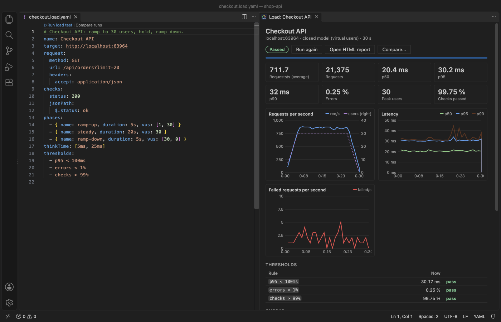
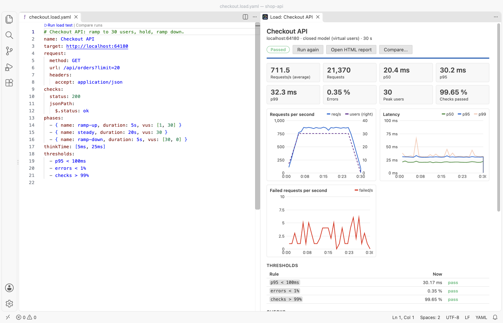
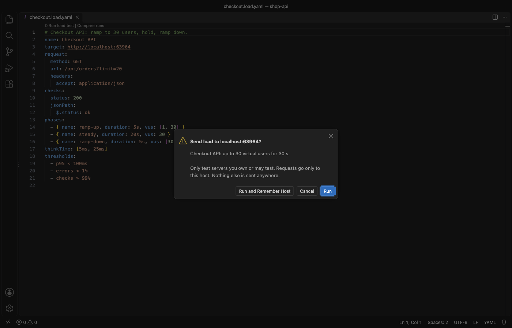

# Load Testing & HTTP Load Tests for APIs

Load test an HTTP API from VS Code. Write a small YAML file, press Run, and watch requests per second and p50, p95 and p99 latency live. Free, no sign-in, no cloud and nothing else to install. The only network traffic is the load you send to the API you test.



- Tests are plain files next to your code (`*.load.yaml` or `*.load.json`), with validation, problems at the right line and key completion.
- Virtual users (closed model) or a fixed rate of requests per second (open model), with ramp-up, steady and ramp-down phases.
- Live dashboard: requests per second, active users, p50/p95/p99 latency, failures, status codes, checks and thresholds. A Stop button ends the run at once.
- Thresholds such as `p95 < 300ms` and `errors < 1%` turn a run into pass or fail.
- Every run is saved as JSON and as an HTML report that opens offline. Compare two runs side by side.
- Import what you already have: `.http` and `.rest` files, cURL commands, HAR recordings, OpenAPI and Swagger documents, and JMeter `.jmx` plans (HTTP samplers).
- The load runs in a background thread, so the editor stays responsive. In the release gate at 2,000 requests per second, the extension host stays less than 100 ms late (the gate fails otherwise).

The dashboard takes its colors from your VS Code theme, light or dark:



## Try it in 30 seconds

Run "Load Testing: Try It on a Demo Server" from the Command Palette. The extension starts a small JSON API on your own computer (127.0.0.1) and runs a 23-second test against it, so you see the dashboard and the report before you point it at your own API.

## Your first test

1. Run "Load Testing: New Load Test" and enter the base URL of your API, for example `http://localhost:3000`.
2. Edit the file. A complete test looks like this:

```yaml
name: Orders API
target: http://localhost:3000
request:
  method: GET
  url: /api/orders?limit=20
  headers:
    accept: application/json
checks:
  status: 200
  maxLatency: 500ms
phases:
  - { name: ramp-up, duration: 10s, vus: [1, 20] }
  - { name: steady, duration: 30s, vus: 20 }
  - { name: ramp-down, duration: 5s, vus: [20, 0] }
thinkTime: [50ms, 150ms]
thresholds:
  - p95 < 300ms
  - errors < 1%
```

3. Click "Run load test" above the first line, or the play button in the editor title bar.
4. The first run against a host asks you to confirm it. The dialog names the host and the load.



## Test file reference

| Key | What it does |
|---|---|
| `target` | Base URL. Request URLs can then be paths. |
| `request` | One request: `method`, `url`, `headers`, and `body`, `json` or `form`. `query` adds query parameters. |
| `steps` | Several requests in a row (one iteration). Each step can `extract` values from its JSON response for the next steps. |
| `phases` | A list of `{ duration, vus }` or `{ duration, rate }`. A number holds steady; `[from, to]` ramps in a straight line. |
| `vus` + `duration` | Short form for one phase. `rate` + `duration` works the same way. |
| `thinkTime` | Pause after each iteration: `100ms`, or `[50ms, 200ms]` for a random pause. |
| `timeout` | Time limit for one request (default 10 s). |
| `checks` | `status` (200, [200, 201] or 2xx), `maxLatency`, `bodyContains`, `bodyNotContains`, `jsonPath` and `header`. |
| `thresholds` | Rules on `p50`, `p90`, `p95`, `p99`, `max`, `avg`, `errors`, `checks`, `rps` and `requests`. |
| `variables` | Values for `{{name}}` placeholders. Built-ins: `{{$uuid}}`, `{{$randomInt 1 100}}`, `{{$timestamp}}`, `{{$isoTimestamp}}`, `{{$vu}}`, `{{$iteration}}`, `{{$processEnv NAME}}`. |
| `data` | A CSV file; each iteration takes the next row, and its columns become `{{column}}` values. |
| `insecure` | `true` allows an invalid or self-signed TLS certificate. Off by default: such a request fails. |
| `maxVus` | Open model only: how many requests may wait at once. |
| `maxBodyKB` | How much of each response is kept for checks (default 1024 KB). The rest is read and counted, not stored. |

A request fails on a network error, a timeout, or a status of 400 or more that your `status` check does not list. Latency is measured from sending the request to the last byte of the response. Time to first byte is in the report too.

## Import requests you already have

- Right-click a `.http`, `.rest`, `.har` or `.jmx` file, or an OpenAPI or Swagger file, and pick "Create Load Test from File". Pick one request for a simple test, or several for a multi-step scenario.
- Select a `curl` command in any editor (or copy it) and run "Create Load Test from cURL". DevTools "Copy as cURL" output works, including `-H`, `--data-raw`, `-u`, `-G` and `-k`.
- REST Client response variables such as `{{login.response.body.$.token}}` become an `extract` step.
- HAR import keeps API requests and leaves out scripts, styles, images and fonts. If the recording has cookies or authorization headers, the new file says so at the top.
- JMeter import reads HTTP samplers, HTTP Request Defaults, Header Managers, User Defined Variables and the thread group (users, ramp-up, duration).
- Files are read in a background thread. A 91 MB HAR file was imported in 3.1 s while the editor kept running.

## Reports and compare

Each run is saved in `load-test-results/` next to the test file: a JSON file with every number and a self-contained HTML report with charts. The report has no script and loads nothing from the network, so you can attach it to a ticket or a pull request. It follows the reader's light or dark setting.

"Load Testing: Compare Two Runs" shows the change in requests per second, p50 to p99, errors and checks, plus the latency curves of both runs. Use it before and after a change to the code or the database.

## Run the same test in CI

The engine is plain Node with no dependency, so CI needs nothing beyond Node 18 or later:

```yaml
# .github/workflows/load-test.yml (run it against a staging or local server you own)
- uses: actions/checkout@v4
- uses: actions/checkout@v4
  with: { repository: theluckystrike/load-testing-vscode, path: .load-testing }
- run: node .load-testing/scripts/ci-run.js tests/checkout.load.yaml --out load-test-results
```

The exit code is 0 when every threshold passes, 1 when one fails and 2 when the test file has a problem. The HTML report is written to `--out`.

## Safety

- Before the first run against a host, a dialog names the host and the load. "Run and Remember Host" stores the answer for this workspace only. "Load Testing: Forget Confirmed Hosts" clears it.
- The engine sends requests only to the hosts you confirmed. A host that comes from a response or a CSV row is refused.
- `loadTesting.maxVirtualUsers` (default 200), `loadTesting.maxRequestsPerSecond` (default 5,000) and `loadTesting.maxDurationMinutes` (default 60) are hard limits: a test that asks for more does not start.
- `loadTesting.blockedHosts` (default `*.gov` and `*.mil`) lists hosts that never receive load.
- Only test servers you own or have permission to test.

## Why this one

The two most installed load testing extensions on the Marketplace either run a separate program or need a cloud account. Their open and closed GitHub issues show the problems below. Each row links the issue and says what this extension does, with the number measured in the release gate (a real VS Code 1.142 with only this extension installed).

| Problem reported by users | Link | What this extension does |
|---|---|---|
| "There's no option to stop the test once it has started." | [k6-vscode-extension #3](https://github.com/grafana-cold-storage/k6-vscode-extension/issues/3) (6 reactions) | A Stop button in the dashboard, the editor title bar and the status bar. In the release gate, Stop must close 100 hanging connections within 0.1 s. |
| A separate program must be installed: the k6 binary on the PATH, or Python and Locust | [detect/index.ts](https://github.com/grafana-cold-storage/k6-vscode-extension/blob/master/src/commands/detect/index.ts) ("make sure it is available in your PATH"), [prerequisites](https://github.com/microsoft/azureloadtesting-extension/blob/main/README.md) | The engine ships inside the extension. The engine is about 175 KB of JavaScript that runs in a worker thread. The gate installs the package into an empty VS Code profile, with no other extension and no setup step, and runs 20 files. |
| The extension stopped working after a change in the Copilot Chat extension it depends on | [azureloadtesting-extension #12](https://github.com/microsoft/azureloadtesting-extension/issues/12), [#11](https://github.com/microsoft/azureloadtesting-extension/issues/11) | No dependency on another extension. The gate runs with VS Code's AI features turned off. |
| "loadtest.config.yaml gets overwritten" | [azureloadtesting-extension #13](https://github.com/microsoft/azureloadtesting-extension/issues/13) | A run never writes to your test file. Results go to a separate folder. The gate checks the sha256 of the test files before and after the runs. |
| Results only as plain text in the Output panel | [k6-vscode-extension #13](https://github.com/grafana-cold-storage/k6-vscode-extension/issues/13) | A live dashboard with charts, plus an HTML report for every run. |
| An Azure account is needed to run tests at scale | [prerequisites](https://github.com/microsoft/azureloadtesting-extension/blob/main/README.md) | No account of any kind. Load comes from your own computer. |

Issue links and texts were read from GitHub on 2026-11-09. The k6 extension's repository is archived. For load across many machines, a cloud service is still the right tool; this extension is for quick, local, repeatable tests while you work.

## How accurate is it

Measured on an Apple Silicon Mac (F = measured on 2026-11-09):

- 120 s at 2,000 requests per second against a local API in another process: 239,783 requests sent, 239,783 counted by the server, 1,998 requests per second, 0 failures. Memory went from 74 MB to 108 MB and stayed there.
- In VS Code, 20 s at 2,000 requests per second: the engine count and the server count matched exactly, and opening a file during the run takes under 250 ms (a gate check).
- Against an endpoint that waits 200 ms, the reported p95 must be within 5 % of the p95 the server measures itself (a gate check).
- When the load generator itself is at its limit (its event loop is busy), the dashboard and the report say so, so a slow laptop is not mistaken for a slow server. When the server is slower than the requested rate, dropped iterations are counted and shown.

Limits: HTTP/1.1 only (no HTTP/2 or WebSocket), one machine, and no browser rendering. Redirects are not followed; a 3xx response is counted as it is.

## Settings

| Setting | Default | Meaning |
|---|---|---|
| `loadTesting.maxVirtualUsers` | 200 | Hard limit on users (and requests in flight in the open model) |
| `loadTesting.maxRequestsPerSecond` | 5000 | Hard limit on the rate |
| `loadTesting.maxDurationMinutes` | 60 | Longest test that may start |
| `loadTesting.blockedHosts` | `*.gov`, `*.mil` | Hosts that never receive load |
| `loadTesting.saveResults` | true | Save JSON and HTML for every run |
| `loadTesting.resultsFolder` | `load-test-results` | Folder next to the test file |
| `loadTesting.maxImportMB` | 200 | Largest file to import |
| `loadTesting.maxDataFileMB` | 100 | Largest CSV data file |
| `loadTesting.askForRating` | true | One rating question after 2 good runs in 2 sessions at least 4 hours apart; never after an error |
| `loadTesting.showSupportLinks` | true | The small links under the dashboard |

## Free

Everything in this extension is free: single requests and multi-step scenarios, CSV data, the dashboard, thresholds, reports, compare, history and every import. There are no ads, no account and no time limit.

## Privacy

No telemetry and no account. The extension sends requests only to the hosts in your test files, after you confirm them. The demo server listens on 127.0.0.1 and stops when VS Code closes. Nothing else leaves your computer.

## Support Zovo

Zovo extensions are free, with no ads and no tracking. They are made by [theluckystrike](https://github.com/theluckystrike) on GitHub. If this one saves you time, you can support the work:

- [Sponsor on GitHub](https://github.com/sponsors/theluckystrike)
- [PayPal](https://www.paypal.com/paypalme/najzzz)
- [Follow theluckystrike on GitHub](https://github.com/theluckystrike)

## More tools by Zovo

- [Swagger Viewer & OpenAPI Viewer (OpenAPI Preview, 3.1, $ref)](https://marketplace.visualstudio.com/items?itemName=zovo.swagger-openapi-viewer) Swagger viewer and OpenAPI preview for VS Code. Live Swagger UI or reference layout for OpenAPI 3.1, 3.0 and Swagger 2.0 in YAML or JSON, with external $ref across files, a problem list with line numbers and copyable text. No server, no port, no sign-in, works offline.
- [HAR Viewer & HAR File Analyzer (HTTP Archive, Network Log)](https://marketplace.visualstudio.com/items?itemName=zovo.zovo-har-viewer) opens HAR files from browser DevTools with a timing waterfall, filters and a redacted copy for sharing.
- [Large JSON Viewer, JSON Browser & JSON Tree](https://marketplace.visualstudio.com/items?itemName=zovo.zovo-json-tree-viewer) shows large JSON files as a searchable tree, copies JSONPath and turns arrays of objects into a table.
- [JSONL Viewer, Large JSONL Table & NDJSON Viewer](https://marketplace.visualstudio.com/items?itemName=zovo.zovo-jsonl-viewer) opens JSONL and NDJSON files as a table, as records or as a chat view.
- [SQLite Viewer & SQLite3 DB File Browser, Database Explorer](https://marketplace.visualstudio.com/items?itemName=zovo.sqlite-table-viewer) browses SQLite tables read-only and runs SELECT queries.

See [all Zovo extensions on the Marketplace](https://marketplace.visualstudio.com/publishers/zovo).

## License

MIT. Bundles `yaml` (ISC); see THIRD-PARTY-NOTICES.md.

## More from zovo

- [All free zovo VS Code extensions](https://marketplace.visualstudio.com/publishers/zovo) — file viewers, database clients, formatters. Offline, no telemetry, no sign-up.
- [Full MCP server catalogue](https://theluckystrike.github.io/mcp/) — local-first MCP servers for back-office work: invoices, VAT, PDFs, spreadsheets, payroll.
- [Hosted no-install MCP endpoints](https://mcp.zovo.one) — paste a URL in Claude / Cursor, nothing to install.
